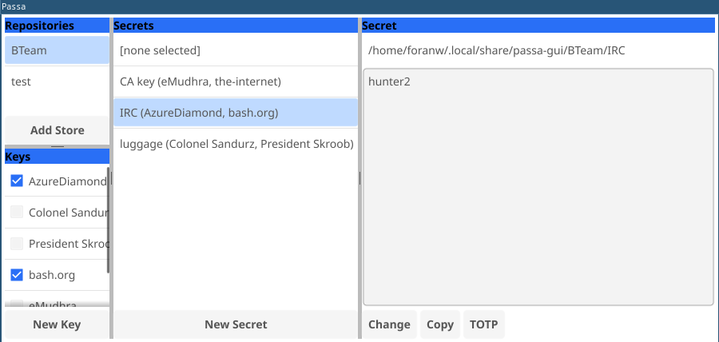

# Passa-GUI

Passa is a multiplayer local-first graphical interface for maintaining a password store across a team where not everyone needs access to every password. 
It is intended to be used with the store on a shared file system or otherwise synced with git.



## Using
  - Import or create a new password store.
  - Import or create individual or group keys.
  - create or modify secret values with one or more specified recipients (encode with age public keys)
  - Private keys for decoding are expected to be shared in a side channel with individuals.


## Backend
`passa` uses age to encrypt passwords for multiple recipients.
The recipient list is stored in `acl` sibling file to secret encrypted in `enc` file.

History is optionally tracked with git on secret value changes.

Keys and imported repos are stored in a `XDG_DATA_HOME` path

The GUI uses fyne.io with golang and was largely constructed with Github copilot in emacs+agent-shell.

## Note
> [NOTE!] A compromise key requires regenerating the key and updating all passwords where it is a recipient.
> Rotating the key alone is insufficient, especially with git history.

## Advanced

```
# launch GUI with keys outside of XDG and for a specific repo
PASSA_STORE_KEYS=example/keys/ \
  ./passa-gui -repo example/store/Movies

# decode secret
PASSA_STORE_KEYS=example/keys/ \
  ./passa-gui dec example/store/Movies/luggage/enc # 12345
```


